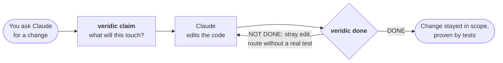

<div align="center">


# Veridic: proof before "done"

### Your coding agent says it's done. Veridic checks.

**It hands the agent the facts about your code before it edits, and won't let it call the work finished until the change stayed in scope and is really tested.**

[](https://www.npmjs.com/package/veridic)
[](#get-started)
[](#how-it-works)
[](https://github.com/cph0r/veridic-bench)
[](LICENSE)

[Get started](#get-started) · [Try it](#try-it) · [How it works](#how-it-works) · [What it catches](#what-it-catches) · [Proof](#proof) · [FAQ](#faq)

<code>/plugin marketplace add cph0r/veridic</code>

<br><br>


</div>

## Get started

You need Node 22.5+, Claude Code, and an Express app (JavaScript or TypeScript).

```text
/plugin marketplace add cph0r/veridic
/plugin install veridic@veridic
```

Then, in your repo, tell Claude **"set up veridic"**, or run it yourself:

```bash
veridic init              # builds the code index; checks your routes are found
veridic init --enforce    # optional: Claude can't finish while Veridic says NOT DONE
```

That's all. From now on Claude uses Veridic on its own when it changes, reviews or documents your code.

## Try it

Paste any of these into Claude Code:

> Add refunds to the orders API.

Claude claims the refund route, sees what that code reaches before touching it, makes the change, and runs `veridic done` until it says DONE.

> What breaks if I change `markPaid`?

> Is our API safe to expose to an AI agent? Show me every GET that writes and every route that moves money.

> Which of our tests don't actually test anything?

> Write a spec for the checkout flow, with every requirement backed by the code.

Or see everything at once:

```bash
veridic report      # or: veridic ui, or /veridic:report in Claude Code
```

One page opens in your browser, with tabs for specs (each requirement with its cited code and tests), routes (what each one really does and who can call it), findings (each with a suggested fix), tests (which ones check nothing), and the change in progress. It's a single local file: no server, nothing uploaded.

## How it works

**claim → edit → done**, on every change.



| When Claude is… | It runs | And gets |
|---|---|---|
| About to edit | `veridic claim "POST /api/refund"` | Every route that code reaches and what each really does (money and deletes first), and the tests that cover it |
| Finishing | `veridic done` | **DONE**, or exactly which change strayed outside the claim, which changed route has no real test, which new test asserts nothing |
| Checking an API for agents | `veridic agent-ready` | What every route really does: reads, writes, deletes, moves money, and which act on ids the caller doesn't own |
| Writing a spec | `/veridic:spec checkout` | Spec Kit–format requirements, each citing the lines that implement it and checked against them |
| Asked "why is it like this?" | `veridic why FR-002` | The commits that wrote that code |

**No model decides any of it.** Every verdict is computed from your code, the git diff and your tests, with the line that proves it, so it can't be talked into passing.

## What it catches

Real catches, on real code:

- **OWASP Juice Shop:** changes a user's password on a `GET`.
- **hackathon-starter** (35k ★): **captures a PayPal payment on a `GET`**, and unlinks accounts on one.
- **ProShop:** any signed-in user can mark any order paid.
- **A popular REST starter:** deletes users with no login at all.
- **A production food-ordering app:** a fix for an order-cancel bug quietly changed how every checkout is created, with no test for it. `veridic done` caught it in 2 seconds.

And on every change Claude makes, the slips that are easy to miss in review:

```text
VERIDIC · done? (no spec)

  · claimed  POST /api/orders/:id/refund
  ✖ seam     1 stray change(s) outside what was claimed
  · reaches  1 changed file(s) behind 2 route(s), 2 that move money or delete
  ✖ tests    1 changed route(s) without an asserting test about them
  · range    HEAD vs working tree

  VERDICT ✖ NOT DONE

  → stray: src/routes/orders.ts:41 (behind GET /api/orders/:id/payment-status) is outside what was claimed
    untested: src/routes/orders.ts changes code behind GET /api/orders/:id/payment-status, and no asserting test that reaches it names the route or the changed function
```

Asked to add refunds, the agent also edited the function that marks orders paid. Veridic names the line and the money route it sits behind.

## Proof

Measured on 10 public Express apps (OWASP Juice Shop, NodeGoat, hackathon-starter, RealWorld and six more), pinned to exact commits, with every verdict checked by hand. Reproduce it in one command: [veridic-bench](https://github.com/cph0r/veridic-bench).

| | |
|---|---|
| Routes found | **353 of 353**, matching an independent scan in every app |
| Problems flagged | **37 of 39 real** (95%), each verdict and reason [published](https://github.com/cph0r/veridic-bench/blob/main/verdicts.json) |
| Tests that check nothing | **9 of 9** confirmed among 3,105 tests |
| Speed | under 4 seconds per app |

Writing a feature spec, against plain Claude Code on two production apps: **$0.94 instead of $2.46, 4.3 instead of 6.6 minutes**, and 100% of stated facts found in the cited code (versus 79–89%).

## FAQ

<details>
<summary><strong>Does my code leave my machine?</strong></summary>

No. Veridic runs locally and sends nothing anywhere: no telemetry, no network calls, no model calls. It reads your code, git history and a local index (`.codegraph/`, built by [CodeGraph](https://github.com/colbymchenry/codegraph), run with its telemetry off), and writes only that index and the files you ask for. See [PRIVACY.md](PRIVACY.md).
</details>

<details>
<summary><strong>Do I need to write specs?</strong></summary>

No. `claim → edit → done` works on any Express repo from the first minute. Specs are optional: when you have one, `veridic done --spec` also checks each requirement's verification criteria.
</details>

<details>
<summary><strong>How is this different from Spec Kit?</strong></summary>

[Spec Kit](https://github.com/github/spec-kit) helps an agent plan *new* work from a spec. Veridic is about the code you already have: what it really does, proven line by line, and whether the agent's change kept it working. It writes specs in Spec Kit's format, so the two fit together.
</details>

<details>
<summary><strong>Will it get in Claude's way?</strong></summary>

Only when the work isn't finished. The Stop hook is off until you run `veridic init --enforce`, and even then it sends Claude back at most once per turn, with exactly what's missing.
</details>

<details>
<summary><strong>Which frameworks?</strong></summary>

Express (JavaScript and TypeScript) today; Fastify, NestJS and Next.js route handlers are next. Effects are recognized for SQL, Drizzle, MongoDB/Mongoose, Sequelize and Prisma.
</details>

<details>
<summary><strong>What does it get wrong?</strong></summary>

It reads middleware by name, so an oddly named auth guard can be misread; it matches tests to routes by name, so a test that never names the route or function counts as missing (it errs toward NOT DONE); and a route prefix computed at run time is left out. Known misses are listed in the [benchmark](https://github.com/cph0r/veridic-bench/blob/main/RESULTS.md).
</details>

<details>
<summary><strong>Can I use it without Claude Code?</strong></summary>

Yes: `npm i -g veridic` or `brew install cph0r/tap/veridic`, then `veridic help`. Every command prints JSON for an agent, and `done`, `metrics`, `impact` and `init` also print a one-screen card with `--card`.
</details>

## Star history

<a href="https://star-history.com/#cph0r/veridic&Date">
  
</a>

## License

[MIT](LICENSE) © Chirag Phor. Formerly *Plumb*.
