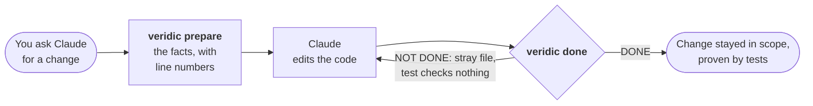

<p align="center">
  
</p>

<p align="center">
  <strong>Your AI agent changes code it doesn't understand, then tells you it's done.<br>
  Veridic gives it proof of what the code does, and checks the work before it says "done".</strong>
</p>

<p align="center">
  <a href="https://www.npmjs.com/package/veridic"></a>
  
  
  
</p>

<p align="center">
  
</p>

---

## What you get

- **Changes that don't break what was already working.** Before your agent edits a feature, Veridic hands it the facts: every route, webhook and timer involved, and what each one really does, each with the exact line that proves it.
- **"Done" that is actually done.** After the edit, Veridic checks the agent's claim: did it only touch what it said it would, and does every requirement have a test that really checks something? If not, the agent gets told what's missing and keeps going.
- **No dangerous surprises.** It finds the code that will hurt you: a `GET` that moves money, an endpoint anyone can use to delete someone else's data, tests that pass but check nothing.

You don't run Veridic. Your agent does. Install it once, and Claude uses it whenever it writes, changes or reviews code.



## What it looks like

Your agent finishes a change and runs the check. Real output:

```text
VERIDIC · done? specs/refunds/spec.md

  · claimed  FR-001
  ✖ seam     1 stray file(s) outside the claimed requirements
  ✖ FR-001   its named test asserts nothing

  VERDICT ✖ NOT DONE

  → stray: src/stripe.ts
    FR-001: its named test asserts nothing
```

So the agent undoes the unrelated edit, writes a test that asserts, and checks again:

```text
VERIDIC · done? specs/refunds/spec.md

  · claimed  FR-001
  ● seam     held: 2 changed file(s), all in the seam of what was claimed
  ● FR-001   covered

  VERDICT ● DONE
```

No model decides that verdict. It's computed from the code, the git diff and the tests, so it can't be talked into passing.

## Proof it works

Measured on 10 public Express apps (OWASP Juice Shop, NodeGoat, hackathon-starter, RealWorld and six more), pinned to exact commits. Full results and the one-command reproduction: [veridic-bench](https://github.com/cph0r/veridic-bench).

| | |
|---|---|
| Routes found | **353 of 353**, matching an independent scan in every app |
| Problems flagged | **37 of 39 confirmed real by hand** (95%), each verdict in [verdicts.json](https://github.com/cph0r/veridic-bench/blob/main/verdicts.json) |
| Tests that check nothing | **9 of 9 confirmed** among 3,105 tests |
| Speed | under 4 seconds per app |

Some of what it caught: Juice Shop changes passwords on a `GET`; hackathon-starter **captures PayPal payments on a `GET`**; ProShop lets any signed-in user mark any order paid; a popular REST starter deletes users with no login at all.

Writing a feature spec with Veridic, against plain Claude Code on two production apps: **$0.94 instead of $2.46, 4.3 instead of 6.6 minutes**, and 100% of stated facts found in the cited code (versus 79–89%), with the known money-losing bugs found in every run.

## Install

```text
/plugin marketplace add cph0r/veridic
/plugin install veridic@veridic
```

Then, once per repo: `veridic init` (or ask Claude to set it up). That's it.

Needs Node 22.5 or newer. Works on Express apps (JavaScript and TypeScript). Without Claude Code: `npm i -g veridic` or `brew install cph0r/tap/veridic`.

## What your agent does with it

| When the agent is… | It runs | And gets |
|---|---|---|
| Starting on a feature | `veridic prepare <routes>` | Everything that belongs to the feature, with code and line numbers |
| Writing a spec | `/veridic:spec <feature>` | Requirements that each cite the code, checked by `veridic check` |
| Finishing a change | `veridic done FR-002` | **DONE**, or exactly which file or test is wrong |
| Asked "is this API safe for agents?" | `veridic agent-ready` | What every route really does: reads, writes, deletes, moves money |
| Keeping specs in step | `veridic stale --fix` (or the git hook) | Citations follow moved code; changed code flags its requirement |
| Asked "why is it like this?" | `veridic why FR-002` | The commits that wrote that code |

Commands print compact JSON for the agent; `done`, `metrics` and `init` also print a one-screen card for you. `veridic help` lists them all.

## Safety

Veridic runs locally and sends nothing anywhere: no telemetry, no network calls, no model calls. It reads your code, git history and a local code index (`.codegraph/`, built by [CodeGraph](https://github.com/colbymchenry/codegraph), which it runs with telemetry off). It writes only the index and the spec files you ask for, and runs your tests only when asked (`--run`). Git and Claude hooks are opt-in.

## Limits

- Express (JS/TS) only for now; Fastify, Hono and Next.js are next.
- Effect detection knows SQL, Drizzle, MongoDB/Mongoose, Sequelize and Prisma.
- Access checks read middleware by name, so an oddly named guard can be misread. Known misses are listed in [RESULTS.md](https://github.com/cph0r/veridic-bench/blob/main/RESULTS.md).

## License

[MIT](LICENSE) © Chirag Phor. Formerly *Plumb*.
