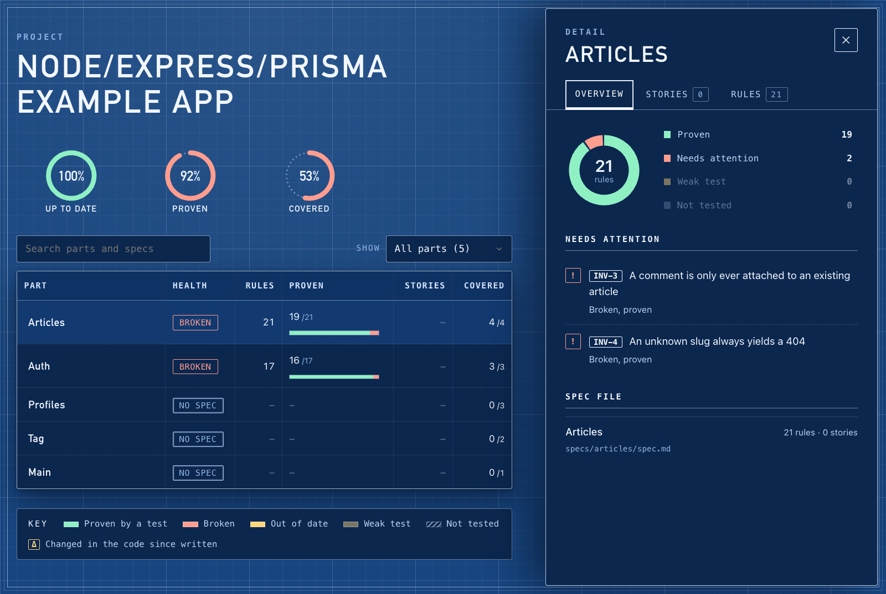

<div align="center">


# Veridic

### Specs for every part of your app, kept true by the code.

[](https://www.npmjs.com/package/veridic)
[](LICENSE)

</div>

Veridic turns your app into specs, checks every rule against the code, and proves it with your tests. When your coding agent changes something, Veridic won't let it call the work done until the change is in scope and tested.

## Get started

Needs Node 22.5+, Claude Code and an Express app.

```text
/plugin marketplace add cph0r/veridic
/plugin install veridic@veridic
```

Then tell Claude **"set up veridic"** in your repo.

## See your app

```bash
veridic report
```



## What to ask Claude

- **"Write specs for every part"**: a spec per part, each rule pointing at its code.
- **"Prove our rules with tests"**: your tests linked to the rules they prove.
- **"Add refunds to the orders API"**: the change, checked until it's in scope and tested.

## Proof

On 10 public Express apps: all 353 routes found, 37 of 39 flagged problems real. Details in [veridic-bench](https://github.com/cph0r/veridic-bench).

Your code never leaves your machine ([privacy](PRIVACY.md)). Without Claude Code: `npm i -g veridic`, then `veridic help`.

## License

[MIT](LICENSE) © Chirag Phor
